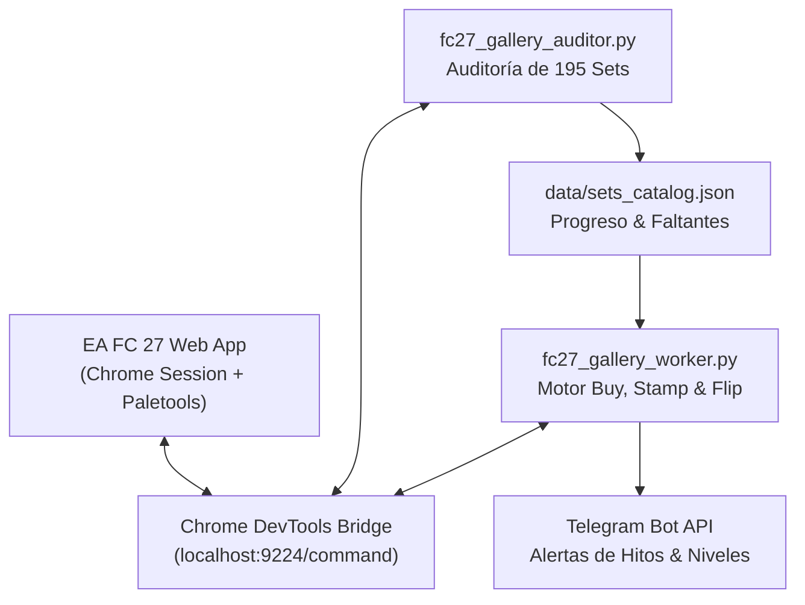

# EA Sports FC™ 27 — Ultimate Team Gallery Automator

> **Motor autónomo de completado de Galería y Álbum para EA Sports FC™ 27 Ultimate Team potenciado por la suite de utilidades Paletools.**  
> Diseñado bajo arquitectura *Zero Focus Theft*, cadencia humana gaussiana y estrategia de reciclaje de capital *"Buy, Stamp & Flip"*.

[](https://www.ea.com/ea-sports-fc/ultimate-team/web-app/)
[](https://paletools.com)
[](https://www.python.org/)
[](LICENSE)

---

## 🌟 Características Principales

* 🎯 **Auditoría Completa de la Galería**: Inspecciona automáticamente las 10 categorías y los 195 sets del catálogo de Paletools / EA, clasificando cartas coleccionadas (*tracked*) y variantes faltantes (*missing*).
* 🔄 **Estrategia "Buy, Stamp & Flip"**:
  1. Compra variantes faltantes baratas ($\le 750$ monedas).
  2. Las mueve al Club para estampar el progreso de por vida en la Galería.
  3. Las transfiere inmediatamente a la Lista de Transferibles y las relista con margen para absorber el impuesto del 5% de EA.
  4. **Reciclaje total de capital**: El saldo de monedas se mantiene o crece gradualmente mientras los sets alcanzan el 100%.
* 🛡️ **Protocolo Anti-Ban Estricto**:
  * **Zero Focus Theft**: Todo corre en una pestaña de Chrome aislada vía DevTools Protocol; no roba foco del mouse, no activa ventanas ni interfiere con tu trabajo.
  * **Jitter Gaussiano Humano**: Intervalos variables aleatorios de 3.5s a 7.5s entre acciones.
  * **Enfriamiento Preventivo**: Pausa obligatoria de 35s cada 6 búsquedas de mercado para evitar *rate-limits*.
  * **Pausa de Lote**: Enfriamiento de 40s tras cada bloque de 3 compras.
  * **Colchón Intocable de Monedas**: Si el saldo baja del límite de seguridad (ej. 35,000 monedas), el motor frena automáticamente.
* 📦 **Auto-Claim & Auto-Cobro**:
  * `clearSoldItems`: Reclama automáticamente los fondos de cartas vendidas al inicio de cada ronda.
  * `claimMetaUTRewards`: Reclama recompensas e hitos de objetivos y pases de temporada en cuanto se desbloquean.
* 📲 **Alertas en Tiempo Real por Telegram**: Notificaciones instantáneas al completar sets al 100%, desbloquear recompensas o pausar por seguridad.

---

## 🏗️ Arquitectura del Sistema



---

## 🚀 Instalación y Puesta en Marcha

### 1. Clonar el Repositorio
```bash
git clone https://github.com/Ranuk-IT-Solutions/fc27-gallery-bot.git
cd fc27-gallery-bot
```

### 2. Configurar Entorno
```bash
cp config.example.json config.json
cp .env.example .env
```
Edita `config.json` o `.env` para especificar el ID de pestaña de Chrome y tus credenciales de Telegram (opcional).

### 3. Requisitos
El proyecto utiliza fundamentalmente la biblioteca estándar de Python (`urllib`, `json`, `csv`, `time`). Para dependencias opcionales:
```bash
pip install -r requirements.txt
```

---

## 📖 Guía de Uso

### Paso 1: Auditar el Catálogo Completo
Ejecuta el auditor para escanear tus 195 sets de Galería y generar la base de datos de cartas faltantes:
```bash
python3 fc27_gallery_auditor.py --tab-id 1233340013
```
Esto creará:
* `data/sets_catalog.json`: Detalle exhaustivo con umbrales de puntuación, notas de rareza y muestras faltantes.
* `data/sets_catalog.csv`: Vista tabular compacta del progreso.

### Paso 2: Ejecutar el Motor de Completado
Inicia el worker autónomo especificando las rondas deseadas y el precio máximo de compra:
```bash
python3 fc27_gallery_worker.py --tab-id 1233340013 --rounds 25 --max-buy 750 --min-buffer 35000
```

#### Argumentos de Línea de Comandos:
| Parámetro | Tipo | Predeterminado | Descripción |
| :--- | :---: | :---: | :--- |
| `--tab-id` | `int` | *Requerido* | ID de la pestaña de Chrome donde corre la Web App |
| `--rounds` | `int` | `25` | Cantidad de cartas a adquirir y rotar en la sesión |
| `--max-buy` | `int` | `750` | Precio máximo en monedas para Buy Now en el mercado |
| `--min-buffer` | `int` | `35000` | Colchón intocable de monedas; frena si el saldo desciende |
| `--endpoint` | `str` | `http://127.0.0.1:9224/command` | Endpoint del bridge de depuración de Chrome |

---

## 📊 Registros y Trazabilidad

Cada transacción y evento se almacena de forma persistente:
* **Transacciones**: `data/transactions.csv` con timestamp, acción (`BUY`, `STAMP`, `LIST`), nombre del set, jugador, precios y estado.
* **Bitácora en Vivo**: `data/worker.log` con seguimiento detallado de cada decisión y respuesta de la API.

---

## 🔒 Privacidad y Seguridad

* **Sin credenciales almacenadas**: El repositorio no almacena credenciales ni tokens reales. Las configuraciones sensibles residen en archivos locales excluidos por `.gitignore`.
* **Uso exclusivo de APIs documentadas de sesión**: El motor interactúa únicamente con la sesión que el usuario ya inició legítimamente en su propio navegador.

---

## 📄 Especificaciones Técnicas

Para una revisión en profundidad de los contratos internos de la Web App (`UTItemEntity`, `ItemPile`, Observers de EA, trampa de caché de mercado y fórmulas matemáticas de reventa), consulta el documento:
👉 **[docs/TECHNICAL_SPECIFICATIONS.md](docs/TECHNICAL_SPECIFICATIONS.md)**

---

## ⚖️ Licencia

Distribuido bajo la Licencia MIT. Consulta `LICENSE` para más información.
