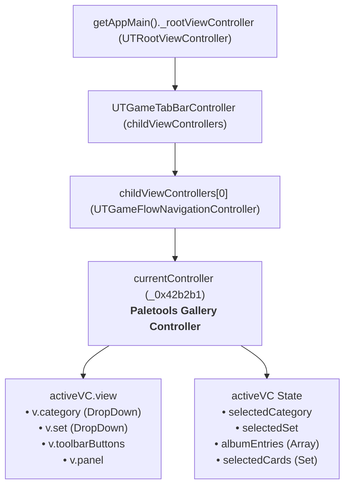
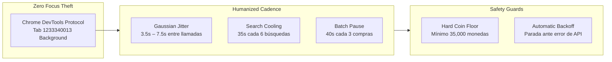

# Especificaciones Técnicas — EA Sports FC™ 27 Ultimate Team Gallery Automator

Este documento consolida la arquitectura, ingeniería inversa, protocolos de red, modelos de datos y directivas de seguridad anti-ban implementadas en el motor de completado de Galería para **EA Sports FC™ 27 Ultimate Team** en conjunto con la suite de utilidades **Paletools**.

---

## 1. Arquitectura de Navegación y Jerarquía de Vistas

La Web App oficial de EA Sports FC 27 opera bajo una arquitectura SPA orientada a View Controllers propietarios (`UTViewController` / `UTGameTabBarController`).



### Propiedades Clave del Controlador de Galería (`_0x42b2b1`):
* `className`: `'_0x42b2b1'` (ofuscado por Paletools).
* `activeVC.selectedSet`: Metadata del set actual (`id`, `name`, `clubEaId`, `requiredItems`, `maxTokens`, `grades`).
* `activeVC.albumEntries`: Colección de todas las variantes del club (objetos con `{ item: UTItemEntity, status: 'tracked' | 'missing' }`).
* `activeVC.selectedCards`: `Set` de `definitionId` seleccionados para la puntuación.
* `activeVC._autoFill()`: Algoritmo interno que maximiza el grading score seleccionando las mejores cartas del set.
* `activeVC._updateGrade()`: Recalcula la puntuación total, bonificaciones por etiqueta (*tag bonuses*), multiplicador efectivo y determina el grado alcanzado (**D, C, B, A, S**).

---

## 2. Contratos y Entidades Nativas de EA Sports

### 2.1 Mapeo de Piles (`ItemPile` Enum)

En la memoria del cliente de EA FC 27, cada ítem reside en un pile específico:

| Constante | Valor Numérico | Descripción |
| :--- | :---: | :--- |
| `ItemPile.ANY` | `0` | Comodín para consultas |
| `ItemPile.TRANSFER` | `5` | Lista de Transferibles (Transfer List) |
| `ItemPile.PURCHASED` | `6` | Sin Asignar (Unassigned / Purchased) |
| `ItemPile.CLUB` | `7` | Club del Usuario |
| `ItemPile.INBOX` | `8` | Bandeja de entrada de recompensas |
| `ItemPile.STORAGE` | `10` | Depósito / SBC Storage |

### 2.2 Entidad `UTItemEntity` vs Objetos Planos

`services.Item.bid(item, price)` **rechaza** objetos literales como `{ id, _auction }`. Requiere la instancia viva de `UTItemEntity` que posee métodos de prototipo como `getAuctionData()`, `isTradeable()`, etc.
* **Solución técnica implementada**: Al ejecutar `services.Item.searchTransferMarket(...)`, las instancias vivas se almacenan globalmente en `window._rkCandidates = validItems` para que la llamada a `bid` use la entidad nativa directa.

### 2.3 Contrato Estricto de los Observers de EA

Los métodos asíncronos de servicios en la Web App (`services.Item`, `services.Club`, `services.Store`, `services.Objectives`) implementan el patrón Observer con una aserción estricta:
```javascript
DebugUtils.assert(JSUtils.isObject(context));
```
Pasar `undefined` o `null` genera una excepción interna que congela la promesa silenciosamente. **Todas las llamadas deben proveer `{}` o `this` como contexto:**
```javascript
services.Item.move(item, ItemPile.CLUB).observe({}, (sender, resp) => { ... });
```

---

## 3. Trampa de Caché del Mercado y Solución

`services.Item.marketRepository` almacena en memoria local las páginas de resultados asociadas a la última búsqueda. Si se busca el Club A y luego el Club B sin purgar la memoria intermedia, el repositorio devuelve la página cacheada del Club A.

* **Solución**: Es mandatorio invocar `services.Item.clearTransferMarketCache()` inmediatamente antes de construir y disparar `services.Item.searchTransferMarket(criteria, 1)`.

---

## 4. Persistencia de la Memoria de la Galería

En EA FC 27, el completado del álbum de la Galería se rige por la presencia histórica de la carta en el club:
1. Una carta comprada entra en `ItemPile.PURCHASED` (`repositories.Item.unassigned`).
2. Al enviarse a `ItemPile.CLUB` vía `services.Item.move(item, ItemPile.CLUB)`, el servidor registra su `definitionId` en el historial del club del usuario.
3. El estado de la carta en `albumEntries` muta irreversiblemente de `'missing'` a `'tracked'`.
4. **Independencia de la carta física**: La carta puede ser transferida a `ItemPile.TRANSFER` y vendida inmediatamente en el mercado de transferencias. **El estado en la Galería permanece como `tracked` para siempre.**

---

## 5. Economía y Reciclaje de Monedas ("Buy, Stamp & Flip")

EA retiene un **5% de impuesto** sobre el valor final de venta de cualquier carta en el mercado.

$$\text{Monedas Netas} = \lfloor \text{Precio Venta} \times 0.95 \rfloor$$

### Reglas de Precios del Motor:
* **Cartas Bronce / Plata (< 450 monedas)**:
  * Precio de compra típico: 200 a 250 monedas.
  * Listado: `startingBid = 200`, `buyNowPrice = 300` a `350`.
  * Rendimiento neto: $300 \times 0.95 = 285$ monedas.
  * **Ganancia neta**: $+35$ a $+85$ monedas por carta estampada.
* **Cartas Oro (500 a 750 monedas)**:
  * Precio de compra típico: 600 a 750 monedas.
  * Listado: `startingBid = precioCompra`, `buyNowPrice = precioCompra + 50`.
  * Rendimiento neto: Absorbe el 5% de EA o genera una pérdida marginal (< 15 monedas), recuperando el 98% del capital de forma instantánea.

---

## 6. Arquitectura Anti-Ban (Defense in Depth)



1. **Zero Focus Theft**: Todo comando se despacha mediante evaluación directa del DOM y contextos JS en la pestaña aislada vía DevTools Protocol. No se roban clics, no se mueven ventanas ni se interrumpe la actividad del usuario en su estación de trabajo.
2. **Jitter Gaussiano**: Retardos aleatorios controlados entre peticiones de búsqueda y compra.
3. **Control de Frecuencia de Búsquedas**: Pausa obligatoria de 35 segundos tras cada bloque de 6 búsquedas de mercado para emular tiempos de lectura de usuario humano y evitar *rate-limits* de EA (HTTP 429 / 521).
4. **Pausa de Lote**: Enfriamiento de 40 segundos tras cada lote de 3 compras exitosas.
5. **Colchón Intocable de Monedas**: Si el saldo en cuenta desciende de la cota fijada (`minCoinsBuffer`), el loop se aborta inmediatamente notificando al usuario.
